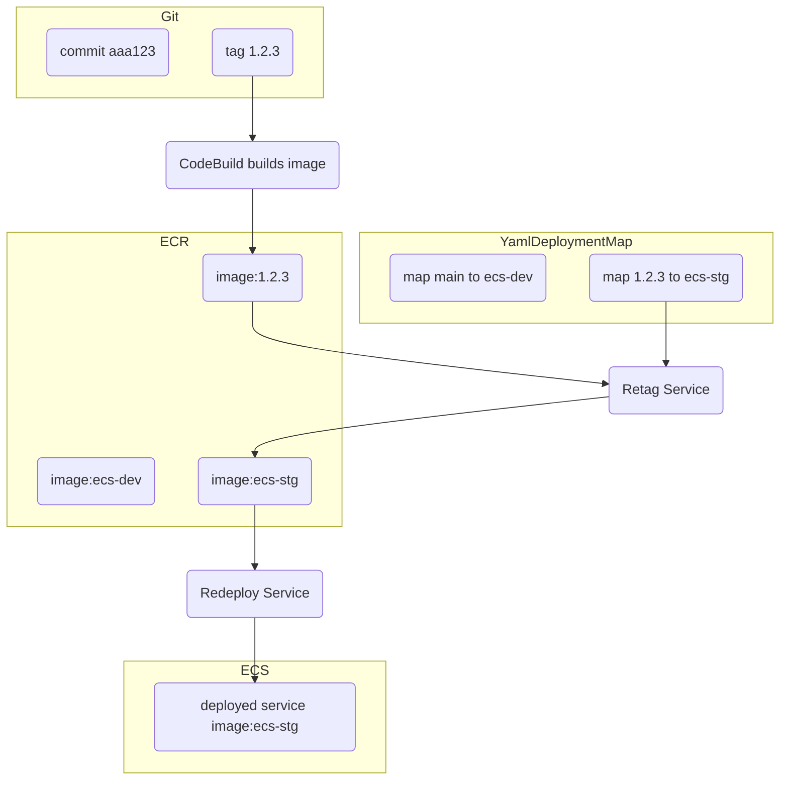
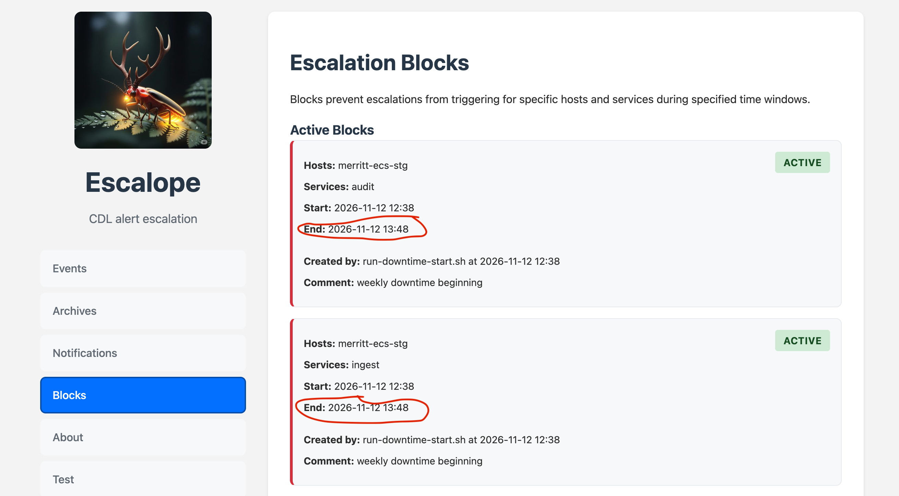
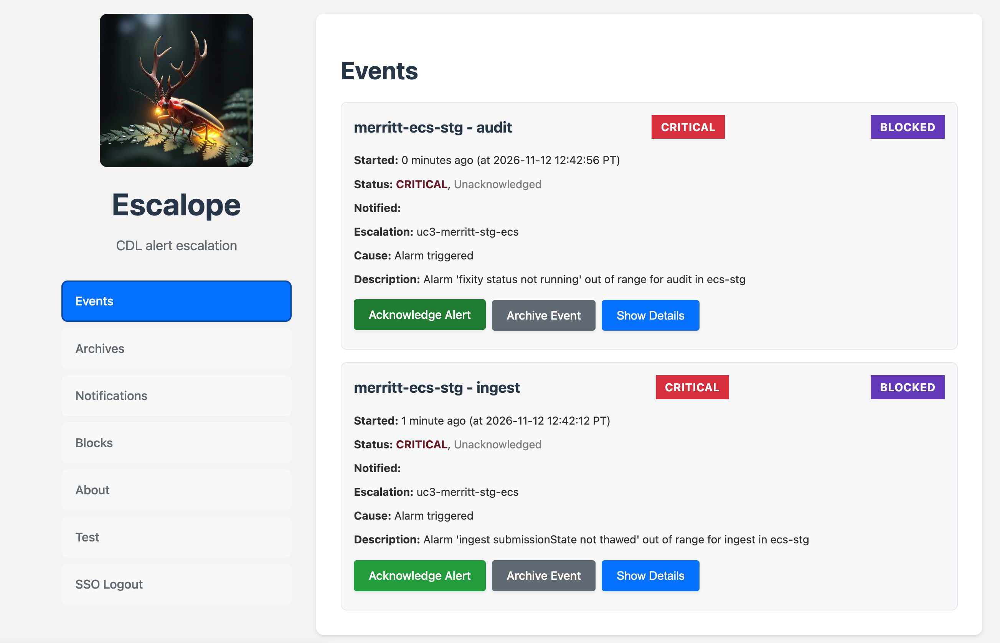
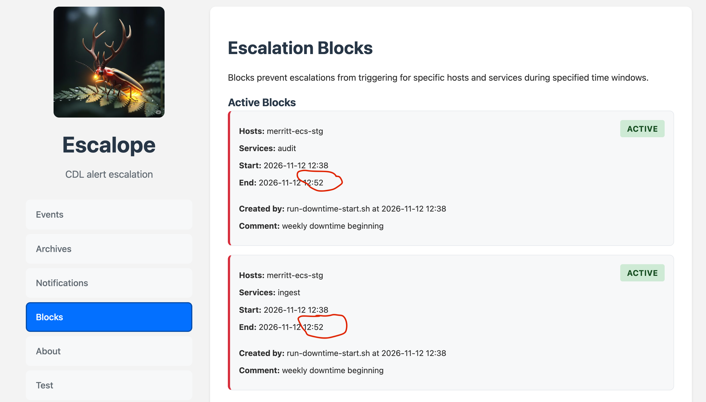
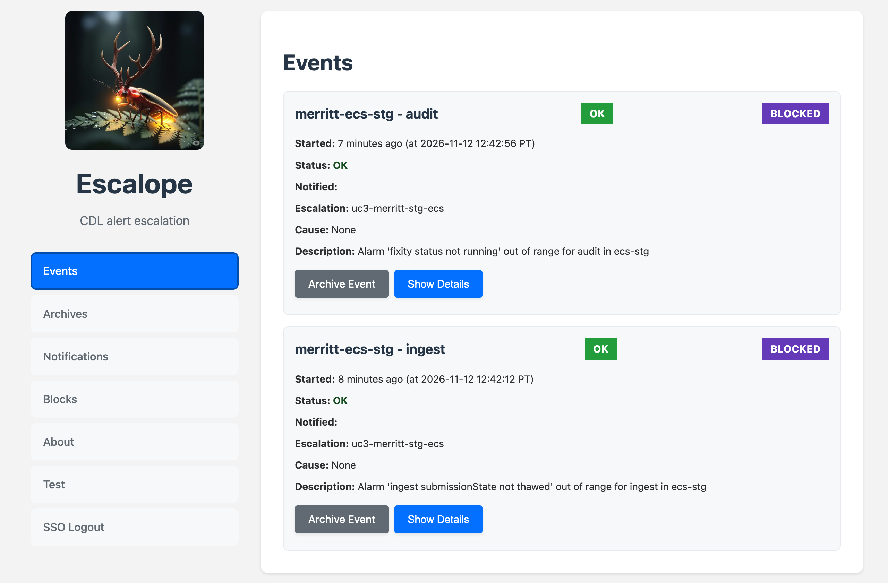
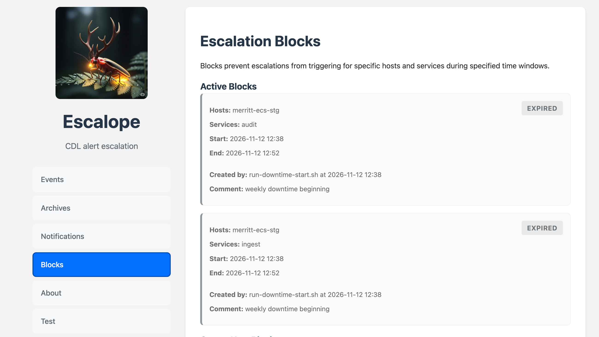
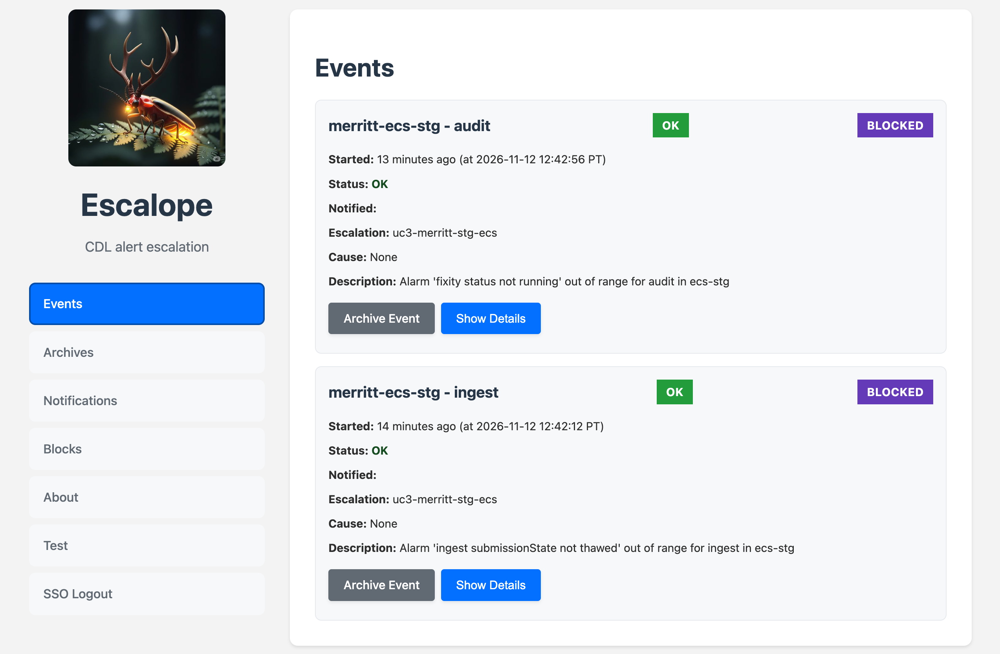

# ECS Stack Re-deploy Script with Escalope Blocking

## Need
- Weekly re-deploy of all services
  - Stage (automated)
  - Prod (manually performed by a team member)
- Weekly coordinated downtime between EZID and Merritt
  - Pause ingest processing
  - Pause fixity processing (in case a MySQL update needs to run)
- Prevent false-alarm escalope alerts

## Scripts

- [Re-deploy Script](../../mrt-inttest-services/merritt-ops/scripts/redeploy-stack.sh#L151-L197)
- [Downtime Start Script](../../mrt-inttest-services/merritt-ops/scripts/run-downtime-start.sh)
- [Downtime End Script](../../mrt-inttest-services/merritt-ops/scripts/run-downtime-end.sh)
- [Bash Functions](../../mrt-inttest-services/merritt-ops/scripts/ecs-helpers.sh#L299-L357)

## IAS Escalope Guide

https://github.com/cdlib/ias-escalope

## Add Escalope Block

```bash
escalope_secret() {
  aws ssm get-parameter --name "/uc3/mrt/escalope_token" --with-decryption --query "Parameter.Value" --output text
}

escalope_add_block() {
  services=$1
  minutes=$2
  created_by=$3
  comment=$4

  # tstart=$(TZ='America/Los_Angeles' date "+%Y-%m-%dT%H:%M:%S")
  # tend=$(TZ='America/Los_Angeles' date -d "now + ${minutes} minutes" "+%Y-%m-%dT%H:%M:%S")

  payload=$(jq -n \
    --arg hosts "merritt-$MERRITT_ECS" \
    --arg services "$services" \
    --arg start_time "now" \
    --arg end_time "${minutes}m" \
    --arg created_by "$created_by" \
    --arg comment "$comment" \
    '$ARGS.named')
  
  curl -X POST "https://escalope.cdlib.org/api/add_block?CDLCognitoBypass=$(escalope_secret)" \
  -H "Content-Type: application/json" \
  -d "$payload"
}
```

## Remove Escalope Block

Note: we do not use this feature because it takes several minutes for an underlying CloudWatch Alarm to resolve.  Rather than removing a block, se reset the expiration time for a block.

```bash
escalope_remove_block() {
  services=$1
  created_by=$2

  payload=$(jq -n \
    --arg hosts "merritt-$MERRITT_ECS" \
    --arg services "$services" \
    --arg created_by "$created_by" \
    '$ARGS.named')

  curl -X POST "https://escalope.cdlib.org/api/remove_block?CDLCognitoBypass=$(escalope_secret)" \
  -H "Content-Type: application/json" \
  -d "$payload"
}
```

## Reset Block Expiration

```bash
escalope_update_block() {
  services=$1
  created_by=$2
  minutes=$3

  payload=$(jq -n \
    --arg hosts "merritt-$MERRITT_ECS" \
    --arg services "$services" \
    --arg created_by "$created_by" \
    --arg end_time "${minutes}m" \
    '$ARGS.named')

  curl -X POST "https://escalope.cdlib.org/api/update_block?CDLCognitoBypass=$(escalope_secret)" \
  -H "Content-Type: application/json" \
  -d "$payload"
}

```

## Communicating with ECS Services

Merritt uses [ECS Service Discovery](https://docs.aws.amazon.com/AmazonECS/latest/developerguide/service-discovery.html) to communicate between containers.  Service discovery containers run as sidecars within our ECS Cluster.

To communicate with each instance of a running service, we use the [servicediscovery api](https://docs.aws.amazon.com/cli/latest/reference/servicediscovery/).

```bash
all_service_ips() {
  local service=$1
  local endpoint=$2
  local ips=$(aws servicediscovery discover-instances \
    --service-name "$service" --namespace-name "merritt-${MERRITT_ECS}" \
    | jq -r '.Instances[].Attributes.AWS_INSTANCE_IPV4')
  for ip in $ips
  do
    echo "http://${ip}:8080/${service}/${endpoint}"
    curl -X POST --no-progress-meter "http://${ip}:8080/${service}/${endpoint}"
  done
}
```

## Service Retag and Redeploy

```bash
service_retag_redeploy() {
  service=$1
  escalope_add_block $service 12 "service_retag_redeploy" ""
  echo "POST $(admintool_base)/infra/retag-redeploy/${service}"
  curl --no-progress-meter -X POST $(admintool_base)/infra/ecs/retag-redeploy/${service}
}
```

### Merritt Tagging Conventions (Git Tagging, Image Tagging, Deploy Tags)



### Service Deployment Yaml

```yaml
  mrt-dashboard:
    ecs-dev: main
    ecs-dbsnapshot: main
    ecs-ephemeral: main
    ecs-stg: 2.3.2
    ecs-prd: 2.3.2
  mrt-ingest:
    ecs-dev: main
    ecs-ephemeral: main
    ecs-stg: 2.5.6
    ecs-prd: 2.5.6
  mrt-store:
    ecs-dev: main
    ecs-ephemeral: main
    ecs-stg: 3.2.1
    ecs-prd: 3.2.1
```

### Re-tag and re-deploy logic
- Look up deployment tag (semantic tag) in our deployment yaml file (copied to S3)
- Grab the ECR image assoicated with that tag
- Re-tag this image with a stack tag: ecs-prd, ecs-stg, etc
- `aws ecs update-service ... --force-new-deployment`

## Escalope Alerts and Escalope Blocks

### Escalope Blocks - After Downtime Start


### Escalope Events - After Downtime Start (Blocked)


### Escalope Blocks - After Downtime End


### Escalope Events - After Downtime End (Resloved AND Blocked)


### Escalope Blocks - After Expiration


### Escalope Events - After Downtime Start (Resoved and Expired)

Note that the expiration does not display on the events page.



## Demo (time permitting)

- In STAGE, run start downtime
- View escalope
- In STAGE, run end downtime